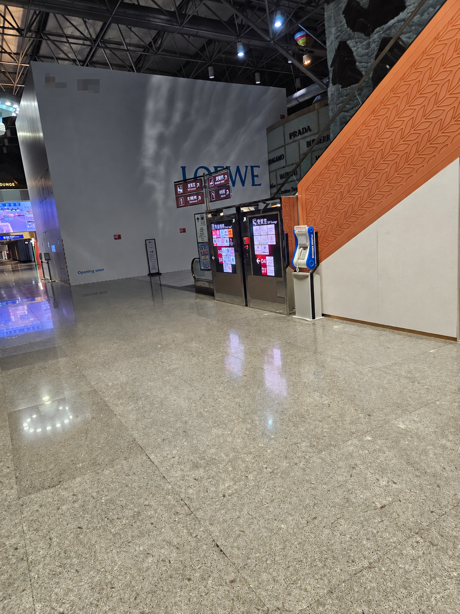
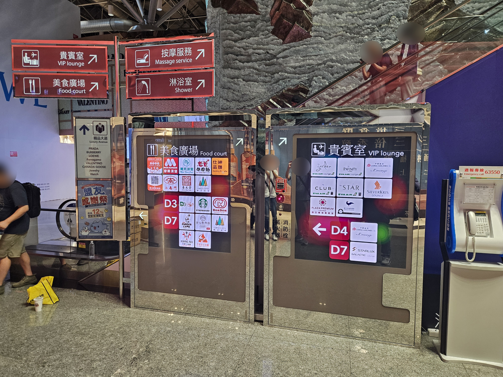
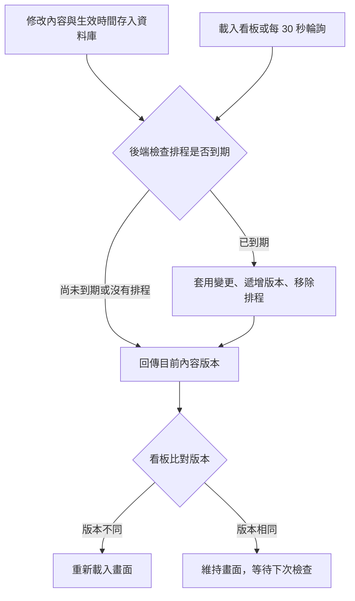

# 桃園機場第二航廈導覽看板

這是我為免稅店客戶開發的導覽系統，已在桃園機場第二航廈管制區上線。一台 IPC 帶動兩面看板，分別提供美食廣場與貴賓室資訊。我負責需求溝通、前後台開發，以及現場部署和後續修改。

*現場安裝照片，左側是美食廣場導覽，右側是貴賓室導覽。*

*近距離照片，可以看清兩面看板的導覽畫面。*

## 使用情境

旅客可以在美食廣場看板上點選店家，查看介紹、照片和位置；貴賓室看板則顯示各家商標與方向。兩面看板都有固定的版位，現場人員可以透過後台更新內容和圖片。

開發過程中，客戶經常調整商標大小、對齊方式和版位細節。我需要一邊確認他們想要的畫面，一邊處理後續維護：哪些細節適合留在 CSS，哪些設定應該交給後台，讓下次修改更方便。

## 把商標對齊做成後台設定

貴賓室的商標各有不同的比例與留白。客戶希望有些置中、有些置底，不能全部套用同一種方式。我和客戶討論時提過，如果把每個商標的對齊方式寫死在 CSS 裡，之後換圖或改位置，就得再改一次程式。客戶仍希望保留各自的對齊方式，我便把這個需求做成可調整的設定。

做法是在資料表中加入 `logo_align` 欄位，支援 `center` 和 `bottom` 兩個值。後台提供選單，前台依設定套用樣式。當時的需求只有置中與置底，用單一欄位就能處理。

上線後不久，客戶又提出了對齊方式的調整。這時後台已經有對應的選項，可以直接修改設定，不必重新改 CSS 或部署程式。

## 先讓客戶選畫面，再整合進正式版本

驗收時，小到某一格移動或縮小 1px，都可能需要調整。我先把卡片和版位的 CSS 拆清楚，方便針對單格修改。遇到還沒確定的樣式，就先做幾個案例頁面，讓客戶看過、選定後，再放進正式版本。

對我來說，拿具體畫面討論比較容易確認彼此的理解，也能知道這次究竟要改哪一個部分。

## 後台發布與排程生效

現場人員修改內容後，會先存成草稿。他們可以預覽兩面看板的結果，確認後立即發布，或指定台北時間上線。

資料庫中的 `stores` 保存已上線內容，`content_changes` 保存草稿，以及最多一筆待生效的變更。選擇排程發布時，修改內容和生效時間會一起存進資料庫，重新啟動程式後仍然讀得到。

兩面看板各自每 30 秒向本機的 `/api/content-version` 發送請求。後端收到請求時，會先讀取待生效的變更，比較 IPC 目前的系統時間與設定的生效時間。只要「目前時間大於或等於生效時間」，就嘗試套用變更；看板第一次載入時，也會做同樣的檢查。

例如內容預計晚上 10 點更新，但設備當時已經關機，隔天早上開機時仍會讀到這筆排程。因為生效時間已過，系統就會補上更新。若只是服務暫時重啟，造成一次輪詢失敗，看板會在下一輪再試。

發布時，店家資料更新、內容版本遞增，以及已發布草稿或排程的移除，會放在同一批資料庫操作中。後端接著回傳最新版本；看板發現版本和目前畫面不同，才重新載入。選擇「立即發布」會直接更新資料庫，已開啟的看板則等下一次輪詢才顯示新內容。

這個做法能補上關機期間錯過的更新，關鍵在於排程有存進資料庫，而且每次都檢查是否已經到期。對這台可能關機、重啟的現場設備來說，比起只在指定時間觸發一次、沒有補執行機制的做法，更容易處理中斷後的恢復，也不需要另外維護常駐排程服務。

取捨是更新會有延遲。正常運作時，看板大致會在下一個 30 秒檢查週期內取得更新；瀏覽器暫停或服務忙碌時可能更久，所以這套設計不保證在指定秒數準時切換。現場不連網，也需要維持 IPC 系統時間正確，排程才會在預期的時間生效。

## 現場部署與交接

看板由一台 IPC 運行，開機後會啟動服務，再開啟兩個 Edge kiosk 視窗，分別顯示美食廣場與貴賓室。現場設備不連網，日常內容更新由工作人員在本機後台操作。

除了前後台，我也處理部署與交接。部署腳本會建置程式、檢查頁面和圖片等資源是否能正常載入，再重新啟動看板。我也整理了圖文操作手冊，說明如何編輯版位、預覽、發布，以及處理待生效的內容。

## 場域規模

依[內政部移民署的 2025 年每日開放資料](https://data.gov.tw/dataset/169891)，加總「桃園二期出境查驗」欄位後，第二航廈全年出境查驗約 **962 萬人次**（9,624,277 人次）。這個數字用來說明航廈的人流規模。專案沒有記錄看板的觀看或點擊次數，因此目前沒有實際使用量或曝光率的數據。

## 工作分工

需求溝通、介面與互動、前後台開發、資料設計、內容發布流程、現場部署和後續維護，都是我負責。商標與地圖在 Illustrator 中的素材拆分，以及 BAT 腳本的初版架構，由其他人完成。

技術使用 React、TypeScript、vinext／Next 路由、Drizzle ORM 與 D1 相容本機資料庫，部署在 Windows IPC，以 Edge kiosk 顯示。

*現場照片經匿名化處理，免稅店標誌已遮蔽。*
